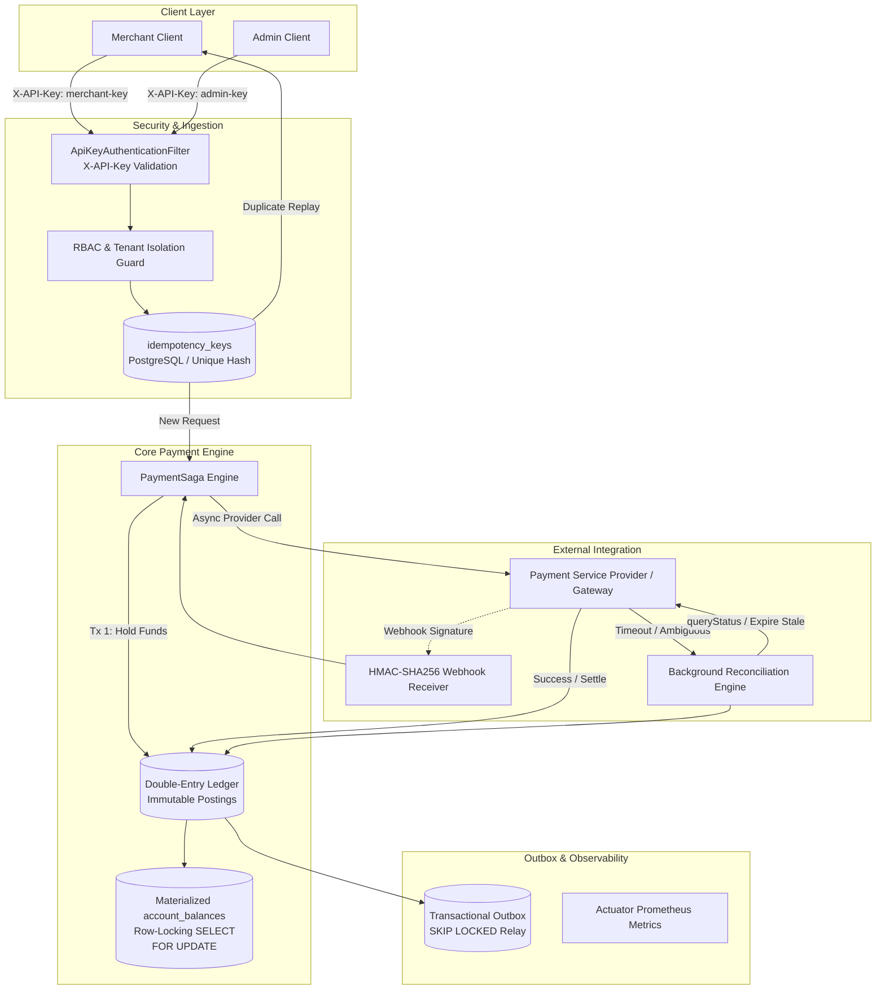

# Payments Ledger & Distributed Wallet Platform 💳

[](https://github.com/Suriya528/payments-ledger-platform/actions/workflows/ci.yml)
[-ED8B00?style=flat&logo=openjdk&logoColor=white)](https://openjdk.org/projects/jdk/21/)
[](https://spring.io/projects/spring-boot)
[](https://spring.io/projects/spring-security)
[](https://www.postgresql.org/)
[-85EA2D?style=flat&logo=swagger&logoColor=black)](http://localhost:8080/swagger-ui.html)
[](https://www.docker.com/)

A financial-grade, production-hardened backend payment engine designed around **Double-Entry Bookkeeping**, **Stateless API Security & Multi-Tenant Authorization**, **Strict Distributed Idempotency with Response Caching**, a **Hold → Settle / Reversal Saga with Gateway Failure Recovery**, a **Transactional Outbox**, and **Continuous Ledger Reconciliation**.

Built specifically to showcase backend engineering depth required by Tier-1 product-based engineering teams (**Stripe, Razorpay, Uber, Amazon Payments, PayPal**).

---

## 🏛️ System Architecture



---

## 💡 Core Engineering Pillars

### 1. Double-Entry Financial Ledger
Financial systems cannot simply increment and decrement balance columns. Every monetary movement must be immutable, traceable, and zero-sum:
- **Debit / Credit Balancing:** Every transaction contains atomic postings where $\sum \text{Debits} + \sum \text{Credits} = 0$.
- **Typed Chart of Accounts:** Accounts are strictly typed (`USER_WALLET`, `MERCHANT_PAYABLE`, `PSP_SUSPENSE`, `FEE_INCOME`, `SYSTEM_RESERVE`).
- **Platform Fee Invariant:** Multi-leg split settlements atomically record gross, net, and platform fees:
  $$\text{Debit } \text{PSP\_SUSPENSE } \$100 = \text{Credit } \text{MERCHANT } \$98 + \text{Credit } \text{FEE\_INCOME } \$2$$
- **PostgreSQL Deferred Constraint Triggers:** At `COMMIT`, a trigger verifies postings balance to zero at the database level.
- **Materialized Balance Cache:** Fast balance queries read from `account_balances` guarded by optimistic locking (`@Version`) and database-level non-negative constraints (`CHECK (balance >= 0)`).

### 2. High-Concurrency Race Condition Protection
- **Deadlock-Free Pessimistic Locking:** Database rows in `account_balances` are acquired with `SELECT ... FOR UPDATE` strictly ordered by account UUID ascending, eliminating circular wait deadlocks.
- **Concurrent Overdraft Prevention:** Verified under high concurrency (100 simultaneous debits against 50 balance units result in exactly 50 approvals, 50 insufficient fund rejections, and zero negative balances).

### 3. Payment Gateway Failure Recovery & Resiliency
Distributed networks fail. If a payment hold commits and the external payment provider times out or experiences a network partition:
- **Preserved Idempotency Claims:** The system **never** deletes or releases the idempotency claim on timeout. Releasing the claim would allow client retries to initiate duplicate holds.
- **State Machine Transition:** Timed-out payments move to `REQUIRES_RECONCILIATION` and return HTTP `202 Accepted` to the caller.
- **Idempotency Response Caching:** The HTTP status code and full response body are persisted in `idempotency_keys.response_body`. Duplicate requests immediately return the cached response without re-executing transactions.
- **Background Active Reconciliation:** The `ReconciliationService` queries the provider via `psp.queryStatus(paymentId)`:
  - If captured at the provider $\rightarrow$ Settles funds to merchant and credits platform fees.
  - If declined or not found $\rightarrow$ Reverses the hold, returning funds to the payer's wallet.

### 4. Production Security & Multi-Tenant Authorization
- **Stateless Spring Security:** All endpoints are protected by `ApiKeyAuthenticationFilter` extracting roles (`ROLE_ADMIN`, `ROLE_MERCHANT`).
- **Admin-Only Operations:** Account creation (`POST /v1/accounts`), wallet injections against the system reserve (`POST /v1/accounts/{id}/fund`), and on-demand reconciliation triggers are restricted to administrators.
- **Tenant Isolation:** Authenticated merchants can only initiate payments payable to their own merchant accounts. Cross-tenant access to balances or ledgers is forbidden (`HTTP 403`).
- **Cryptographic Webhook Signatures:** Inbound webhooks from the payment gateway are verified using HMAC-SHA256 signatures before processing.

### 5. Transactional Outbox Pattern
- **Eliminating Dual-Writes:** State changes and event payloads are committed atomically to the `outbox` table in the same local database transaction.
- **Concurrency-Safe Drain:** The background relay uses `SELECT ... FOR UPDATE SKIP LOCKED` to publish events without thread contention.

---

## 🔑 Authentication & API Key Roles

Pass the `X-API-Key` HTTP header with every request:

| Role | API Key | Permitted Actions |
|---|---|---|
| **Platform Admin** | `admin-live-key-secret-999` | Create accounts, fund user wallets, run reconciliation audits, query any balance/ledger |
| **Merchant Acme** | `merchant-acme-key-123` | Process payments for `acme-store`, query Acme merchant balance and ledger |
| **Merchant M1** | `merchant-m1-key-456` | Process payments for `m1`, query M1 merchant balance and ledger |

---

## 🚀 Quickstart & Interactive Testing

### Option A: Local Dev Mode (Zero Dependencies Required)
No Docker daemon or PostgreSQL installation needed! The application includes an embedded in-memory H2 profile with PostgreSQL compatibility mode, automatic schema creation, and system account provisioning.

```bash
# Clone the repository
git clone https://github.com/Suriya528/payments-ledger-platform.git
cd payments-ledger-platform

# Run with Maven Wrapper
./mvnw spring-boot:run "-Dspring-boot.run.profiles=local"

# On Windows PowerShell:
.\mvnw.cmd spring-boot:run "-Dspring-boot.run.profiles=local"
```

Once running, explore and test the endpoints directly:
- **Interactive Swagger UI:** [`http://localhost:8080/swagger-ui.html`](http://localhost:8080/swagger-ui.html) (Click **Authorize** and enter `admin-live-key-secret-999` or `merchant-acme-key-123`)
- **Actuator Health:** [`http://localhost:8080/actuator/health`](http://localhost:8080/actuator/health)
- **Prometheus Metrics:** [`http://localhost:8080/actuator/prometheus`](http://localhost:8080/actuator/prometheus)

### Option B: Production Container with Docker & PostgreSQL 16
```bash
docker compose up --build
```
- API: `http://localhost:8080`
- Prometheus: `http://localhost:9090`
- Grafana: `http://localhost:3000` (Pre-configured datasource & dashboards)

---

## 🧪 Complete cURL Walkthrough

### 1. Provision Accounts (Admin Only)
```bash
# Create User Wallet (Alice)
curl -X POST http://localhost:8080/v1/accounts \
  -H "X-API-Key: admin-live-key-secret-999" \
  -H "Content-Type: application/json" \
  -d '{"ownerType":"USER","ownerId":"alice","type":"USER_WALLET","currency":"INR"}'
# => Returns: { "id": "11111111-1111-1111-1111-111111111111", ... }

# Fund Alice's Wallet with 100,000 minor units (₹1,000.00) via double-entry deposit from SYSTEM_RESERVE
curl -X POST http://localhost:8080/v1/accounts/11111111-1111-1111-1111-111111111111/fund \
  -H "X-API-Key: admin-live-key-secret-999" \
  -H "Content-Type: application/json" \
  -d '{"amount": 100000}'

# Create Merchant Account (M1)
curl -X POST http://localhost:8080/v1/accounts \
  -H "X-API-Key: admin-live-key-secret-999" \
  -H "Content-Type: application/json" \
  -d '{"ownerType":"MERCHANT","ownerId":"m1","type":"MERCHANT_PAYABLE","currency":"INR"}'
# => Returns: { "id": "22222222-2222-2222-2222-222222222222", ... }
```

### 2. Execute an Idempotent Payment (Merchant M1)
```bash
curl -i -X POST http://localhost:8080/v1/payments \
  -H "X-API-Key: merchant-m1-key-456" \
  -H "Content-Type: application/json" \
  -H "Idempotency-Key: pay-key-001" \
  -d '{
    "merchantId": "m1",
    "payerAccountId": "11111111-1111-1111-1111-111111111111",
    "payeeAccountId": "22222222-2222-2222-2222-222222222222",
    "amount": 2500,
    "currency": "INR"
  }'
```
> **Try re-sending the exact same request above!** The server detects the idempotency claim, returns HTTP `201 Created` with the cached response payload, and debits Alice's account **exactly once**.

### 3. Verify Continuous Ledger Integrity & Audit Report
```bash
# Verify ledger balance equation: sum(debits) - sum(credits) == 0
curl http://localhost:8080/v1/reconciliation/report \
  -H "X-API-Key: admin-live-key-secret-999"

# Response:
# { "balanced": true, "ledgerNet": 0, "driftedAccounts": 0 }
```

---

## 📊 Comprehensive Test Suite (41 Tests)

The test suite runs with zero manual setup and passes across all environments:

```bash
# Windows
.\mvnw.cmd test

# Linux / macOS
./mvnw test
```

### Verified Test Categories:
- **`PaymentServiceConcurrencyIT`:** 50 concurrent requests fired with the same idempotency key simultaneously; verifies exactly 1 payment created, 49 duplicate conflicts caught by database constraints, zero double-charges.
- **`LedgerConcurrencyIT`:** 100 concurrent debits against 50 balance units; verifies pessimistic row locking, deterministic lock ordering, exactly 50 successes, 50 insufficient funds rejections, balance stays $\ge 0$.
- **`PaymentControllerIT`:** Security authorization tests, unauthenticated 401, currency mismatch 422, gateway timeout 202 with `REQUIRES_RECONCILIATION`, and cached replay.
- **`AccountControllerTest`:** Admin-only account creation, admin-only wallet funding, merchant access isolation.
- **`RefundControllerIT` & `RefundServiceIT`:** Full and partial refunds, multi-leg platform fee reversals, over-refund protection.
- **`ReconciliationIT` & `StaleHoldExpiryIT`:** Automated audit scan, detection of unrecorded database tampering, automated expiration of stale holds.
- **`PspWebhookControllerIT` & `WebhookCaptureIT`:** HMAC-SHA256 signature verification, duplicate webhook idempotency.
- **`OutboxRelayIT` & `OutboxWriteIT`:** Atomicity of transactional outbox records and `SKIP LOCKED` publisher relay.

---

## 🎯 Technical Interview Discussion Guide

### Q1: How does your system recover when the external payment gateway times out?
> **Answer:** In `PaymentService.create()`, after the funds hold commits, we invoke the PSP outside the database transaction. If the gateway times out or drops the connection, we catch `PspTimeoutException`. Instead of deleting the idempotency key (which would invite duplicate charges on retry), we keep the idempotency claim in `COMPLETED`, persist the status as `REQUIRES_RECONCILIATION`, attach the payment ID, cache the serialized response body, and return `202 Accepted`. The background `ReconciliationService` queries the PSP's status API (`queryStatus`), settling the payment if captured or reversing the hold if declined.

### Q2: Why did you implement PostgreSQL-backed idempotency instead of Redis?
> **Answer:** Using Redis for financial idempotency introduces dual-write anomalies: if Redis stores the key but the PostgreSQL database transaction rolls back, or if Redis evicts keys under memory pressure, clients can experience phantom duplicates. By storing idempotency records in PostgreSQL with a database-level `UNIQUE (merchant_id, idem_key)` constraint, the idempotency claim is atomic with the transactional outbox and ledger entries, eliminating split-brain risks during network partitions.

### Q3: How do you prevent deadlocks during concurrent multi-account transfers?
> **Answer:** A classic deadlock occurs when Thread 1 transfers $A \rightarrow B$ while Thread 2 transfers $B \rightarrow A$. Both threads lock their source accounts with `SELECT ... FOR UPDATE` and wait indefinitely for the other account. We eliminate this by sorting account UUIDs in ascending order before acquiring any row locks: both threads will attempt to lock account $\min(A, B)$ first and $\max(A, B)$ second, making circular wait deadlocks mathematically impossible.

---

## 📄 License
MIT License. Authored and maintained by [Suriya528](https://github.com/Suriya528).
