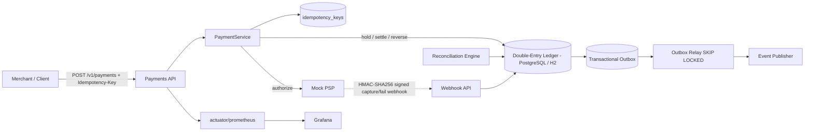

# Payments + Double-Entry Wallet Service 💳

[-ED8B00?style=flat&logo=openjdk&logoColor=white)](https://openjdk.org/projects/jdk/21/)
[](https://spring.io/projects/spring-boot)
[-85EA2D?style=flat&logo=swagger&logoColor=black)](http://localhost:8080/swagger-ui.html)
[](https://www.postgresql.org/)
[](https://www.docker.com/)

A production-grade, financial-grade backend engine designed around **Double-Entry Accounting**, **Strict Distributed Idempotency**, a **Hold → Settle / Reverse Saga**, a **Transactional Outbox**, and **Continuous Reconciliation**.

Built specifically to showcase backend engineering depth required by Tier-1 product-based companies (**Stripe, Razorpay, Uber, Amazon Payments, PayPal**).

---

## 🏛️ System Architecture



### 💡 Core Accounting Principles
Money moves between typed accounts (`USER_WALLET`, `MERCHANT_PAYABLE`, `PSP_SUSPENSE`, `FEE_INCOME`, `SYSTEM_RESERVE`):
1. **Double-Entry Rule:** Every transaction consists of balanced postings where $\sum \text{Debits} + \sum \text{Credits} = 0$.
2. **Deterministic Lock Ordering:** Balance rows are locked via `SELECT ... FOR UPDATE` in ascending account ID order to eliminate circular deadlocks.
3. **Defense-in-Depth:** In addition to application validation, PostgreSQL deferred constraint triggers verify that postings net to zero at the database level before commit.
4. **Materialized Reconciled Cache:** Account balances are cached in `account_balances` with `@Version` and non-negative constraints (`balance >= 0`), continuously audited against historical postings by the reconciliation worker.

---

## 🚀 Quickstart & Interactive Testing

### Option A: Local Dev Mode (Zero Dependencies Required)
No Docker daemon or PostgreSQL installation needed! The application includes an embedded in-memory H2 profile with PostgreSQL dialect support and automatic account seeding.

```bash
# Clone the repository
cd payments-wallet-service

# Run with Maven Wrapper
./mvnw spring-boot:run -Dspring-boot.run.profiles=local
# On Windows PowerShell:
.\mvnw.cmd spring-boot:run -Dspring-boot.run.profiles=local
```

Once running, explore and test the endpoints directly:
- **Interactive Swagger UI:** [`http://localhost:8080/swagger-ui.html`](http://localhost:8080/swagger-ui.html)
- **Actuator Health:** [`http://localhost:8080/actuator/health`](http://localhost:8080/actuator/health)
- **Prometheus Metrics:** [`http://localhost:8080/actuator/prometheus`](http://localhost:8080/actuator/prometheus)

### Option B: Production Mode with Docker & PostgreSQL
```bash
docker compose up --build
```
- API: `http://localhost:8080`
- Prometheus: `http://localhost:9090`
- Grafana: `http://localhost:3000` (Pre-configured datasource & dashboard)

---

## 🧪 Quick Test Walkthrough (cURL)

### 1. Create a User Wallet & Merchant Account
```bash
# 1. Create User Wallet
curl -X POST http://localhost:8080/v1/accounts \
  -H "Content-Type: application/json" \
  -d '{"ownerType":"USER","ownerId":"user-101","type":"USER_WALLET","currency":"INR"}'

# Response contains: "id": "<USER_WALLET_ID>"

# 2. Fund the Wallet (Double-entry deposit)
curl -X POST http://localhost:8080/v1/accounts/<USER_WALLET_ID>/fund \
  -H "Content-Type: application/json" \
  -d '{"amount": 50000}'

# 3. Create Merchant Account
curl -X POST http://localhost:8080/v1/accounts \
  -H "Content-Type: application/json" \
  -d '{"ownerType":"MERCHANT","ownerId":"merchant-acme","type":"MERCHANT_PAYABLE","currency":"INR"}'
```

### 2. Execute an Idempotent Payment
```bash
curl -i -X POST http://localhost:8080/v1/payments \
  -H "Content-Type: application/json" \
  -H "Idempotency-Key: e1a2b3c4-d5e6-7f8a-9b0c-1d2e3f4a5b6c" \
  -d '{
    "merchantId": "merchant-acme",
    "payerAccountId": "<USER_WALLET_ID>",
    "payeeAccountId": "<MERCHANT_ACCOUNT_ID>",
    "amount": 2500,
    "currency": "INR"
  }'
```
> **Try re-sending the exact same request above!** The system detects the idempotency key, returns HTTP `201 Created` with the replayed payment state, and debits the user's wallet **exactly once**.

### 3. Verify Ledger Balance & Audit Trail
```bash
# Check wallet balance
curl http://localhost:8080/v1/accounts/<USER_WALLET_ID>/balance

# Inspect immutable ledger postings (debits/credits)
curl http://localhost:8080/v1/accounts/<USER_WALLET_ID>/ledger

# Audit ledger integrity (must report balanced: true, net: 0, drifted: 0)
curl http://localhost:8080/v1/reconciliation/report
```

---

## 📐 Key Design Patterns & Engineering Highlights

| Pattern | Problem Solved | Implementation Detail |
|---|---|---|
| **Double-Entry Bookkeeping** | Prevents funds from disappearing or appearing out of nowhere | Postings are immutable; `assertBalanced()` verifies $\sum = 0$; Postgres trigger guarantees DB consistency |
| **Durable Idempotency** | Prevents double-charging during network drops and client retries | `(merchant_id, idem_key)` unique constraint with `IN_PROGRESS` / `COMPLETED` lifecycle and SHA-256 payload validation |
| **Deadlock-Free Locking** | Concurrency race conditions when users transfer money simultaneously | Rows in `account_balances` are locked using `SELECT ... FOR UPDATE` sorted strictly by account UUID ascending |
| **Hold → Settle Saga** | Slow or failing payment gateways blocking database connections | Payer funds moved to `PSP_SUSPENSE` in Tx 1; Gateway called asynchronously outside DB transaction; Settled to payee in Tx 2 |
| **Transactional Outbox** | Dual-write inconsistency between database and event stream/broker | Domain events written into `outbox` table in the same DB transaction; drained by scheduled relay using `FOR UPDATE SKIP LOCKED` |
| **Reconciliation Job** | Silent corruption or data drift detection | Background scheduled task recalculates $\sum(\text{postings}) \stackrel{?}{=} \text{balance}$ for all accounts and expires abandoned holds |

---

## 🎯 Product Company Interview Cheat Sheet

### Q1: How do you prevent two concurrent requests from overdrawing a wallet?
> **Answer:** We use row-level pessimistic locking (`SELECT ... FOR UPDATE`) on the balance row. To prevent deadlocks when transfers happen concurrently between accounts (e.g. A→B and B→A), we sort the accounts by UUID before acquiring locks. Inside the transaction, we verify that the current balance minus the debit amount is $\ge 0$. Any overdraft attempt immediately throws `InsufficientFundsException` and rolls back the transaction.

### Q2: Why use a double-entry ledger instead of updating a balance column?
> **Answer:** A simple `UPDATE users SET balance = balance - 100` lacks auditability and traceability. If a balance is wrong, you cannot determine why. In a double-entry ledger, postings are append-only. The balance is merely a materialized cache computed from immutable postings. Money cannot move without a corresponding debit and credit.

### Q3: What is the dual-write problem and how does the outbox pattern solve it?
> **Answer:** If you update a database and publish an event to Kafka/RabbitMQ in the same method, a network blip or crash between the two creates inconsistency (either the DB updated but the event wasn't sent, or vice versa). The Transactional Outbox pattern writes the event into an `outbox` table within the **same local database transaction**. A separate relay process reads and publishes them using `SELECT ... FOR UPDATE SKIP LOCKED`, guaranteeing at-least-once delivery.

---

## 🧪 Running Automated Tests

Run the test suite including the multi-threaded concurrency and race condition tests:

```bash
# Windows
.\mvnw.cmd test

# Linux / Mac
./mvnw test
```
